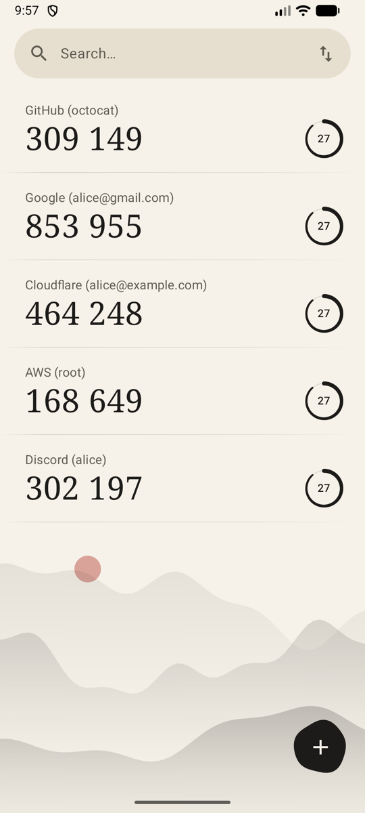
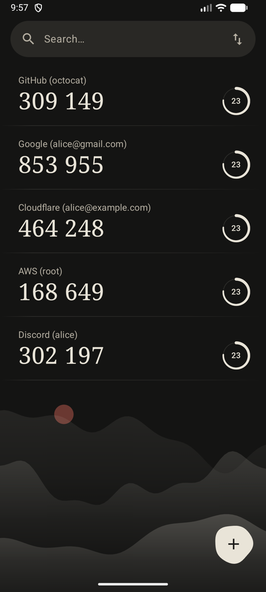
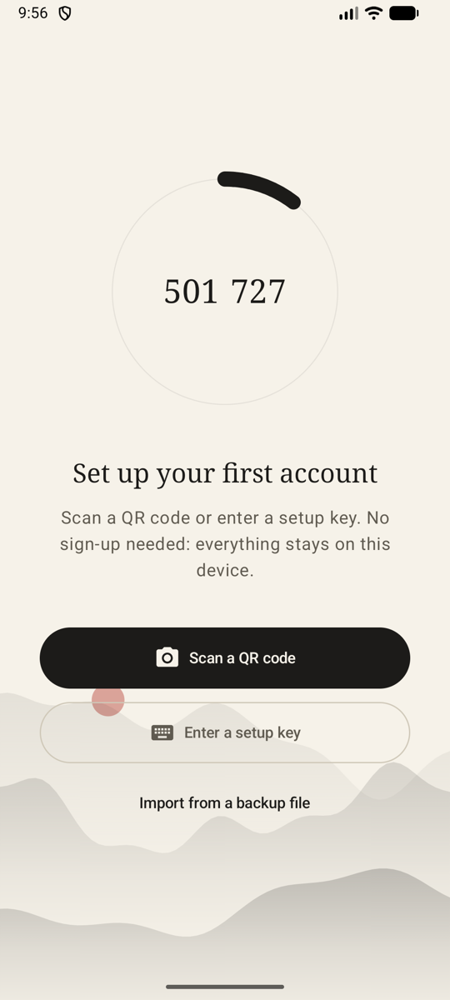

<div align="center">
  <h1>KAuth</h1>
  <p><b>An offline two-factor authenticator for Android. No account, no network, no tracking.</b></p>
  <p>English · <a href="README_CN.md">中文</a></p>
  <a href="https://github.com/YangChengTeam/kauth/releases"></a>
  <a href="LICENSE"></a>
  <a href="https://github.com/YangChengTeam/kauth/actions/workflows/ci.yml"></a>
  
</div>

<p align="center">
  
  
  
</p>

## Features

- **Fully offline**: The app has no `INTERNET` permission. Codes are made on the phone and nothing leaves it
- **Standard codes**: TOTP and HOTP, SHA1/SHA256/SHA512, 6 to 8 digits, any period
- **Scan or type**: Scan `otpauth://` QR codes with the camera, or enter a setup key by hand
- **Leave Google Authenticator**: Scan its "Transfer accounts" QR codes, including exports split over several codes
- **Encrypted at rest**: Secrets are encrypted with an AES-GCM key held in the Android Keystore
- **Move phones yourself**: Export to a password-protected file (PBKDF2 + AES-GCM) and import it on the new phone. Duplicates are skipped
- **Ink-wash design**: Light and dark themes, search, tap to copy

## Install

Download the APK from [Releases](https://github.com/YangChengTeam/kauth/releases/latest) and open it on your phone. Requires Android 8.0 or newer.

Each release lists `SHA256SUMS`. The signing certificate's SHA-256 is:

```
38:4C:B7:15:44:DB:21:F9:68:0B:94:1B:1F:6F:F7:BC:B4:87:96:D1:16:00:A7:ED:68:BA:CF:F9:C4:1F:AE:E8
```

## Moving from Google Authenticator

1. In Google Authenticator, open the menu, then **Transfer accounts** › **Export accounts**
2. In KAuth, tap **+** › **Scan a QR code**
3. Scan each code it shows. KAuth tells you how many are left

## Build

```bash
git clone https://github.com/YangChengTeam/kauth.git && cd kauth
./gradlew test             # Unit tests
./gradlew assembleDebug    # app/build/outputs/apk/debug/app-debug.apk
```

Needs JDK 17+ and the Android SDK. The code is Kotlin and Jetpack Compose, split into `core/*` (model, OTP, storage, backup, design system) and `feature/*` (home, setup, scan) modules.

## Release

Push a version tag and [`release.yml`](.github/workflows/release.yml) builds, signs and publishes the APK:

```bash
git tag v1.1.0 && git push origin v1.1.0
```

## License

[MIT](LICENSE)
