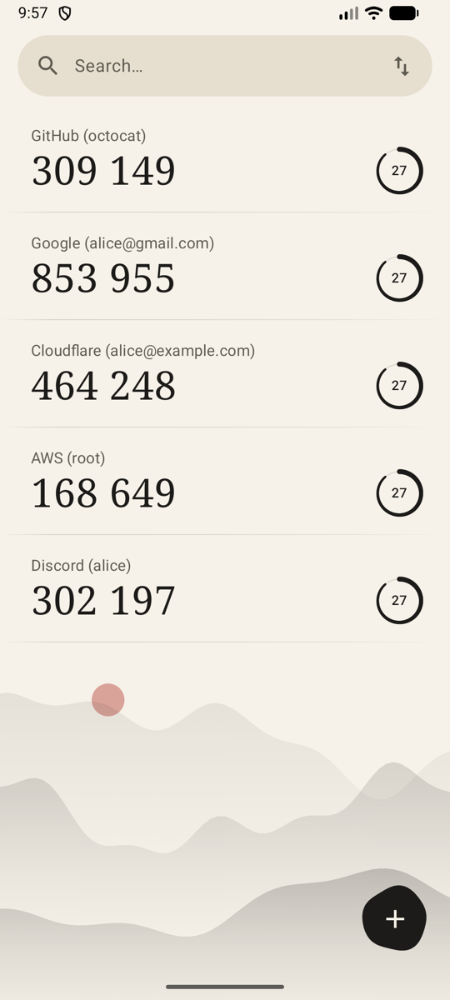
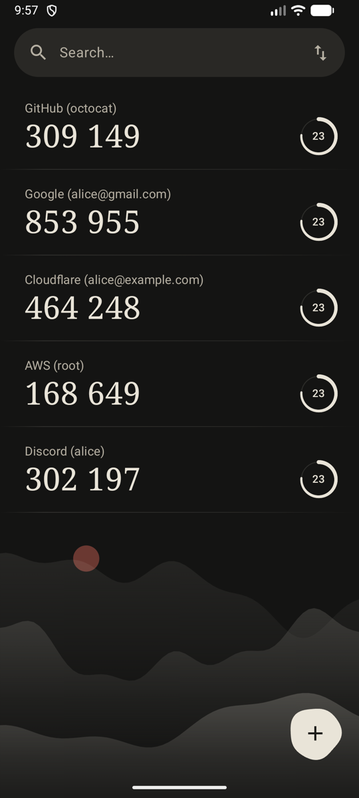
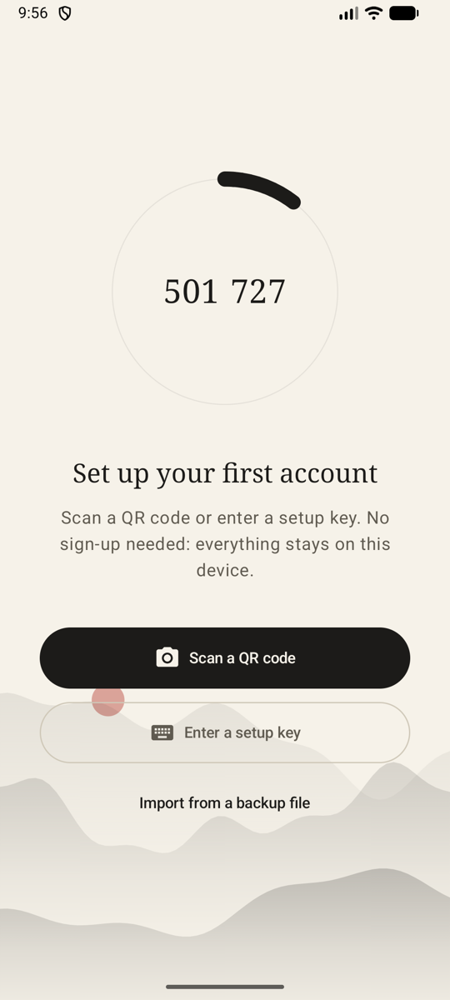

<div align="center">
  <h1>KAuth</h1>
  <p><b>离线的 Android 两步验证器。不用注册、不联网、不追踪。</b></p>
  <p><a href="README.md">English</a> · 中文</p>
  <a href="https://github.com/YangChengTeam/kauth/releases"></a>
  <a href="LICENSE"></a>
  <a href="https://github.com/YangChengTeam/kauth/actions/workflows/ci.yml"></a>
  
</div>

<p align="center">
  
  
  
</p>

## 功能

- **完全离线**：应用没有申请 `INTERNET` 权限，验证码在手机上生成，数据不会离开手机
- **标准验证码**：支持 TOTP 和 HOTP、SHA1/SHA256/SHA512、6 到 8 位、任意周期
- **扫码或手输**：用相机扫 `otpauth://` 二维码，或手动输入设置密钥
- **从 Google Authenticator 迁移**：直接扫它的“转移账号”二维码，账号多、分成几张码也行
- **加密存储**：密钥用存在 Android Keystore 里的 AES-GCM 密钥加密
- **自己换手机**：导出成带密码的文件（PBKDF2 + AES-GCM），在新手机上导入，重复的账号会自动跳过
- **水墨风格**：浅色和深色主题、搜索、点一下就复制

## 安装

在 [Releases](https://github.com/YangChengTeam/kauth/releases/latest) 下载 APK，在手机上打开安装。需要 Android 8.0 或更高版本。

每个版本都附带 `SHA256SUMS`。签名证书的 SHA-256：

```
38:4C:B7:15:44:DB:21:F9:68:0B:94:1B:1F:6F:F7:BC:B4:87:96:D1:16:00:A7:ED:68:BA:CF:F9:C4:1F:AE:E8
```

## 从 Google Authenticator 迁移

1. 在 Google Authenticator 里打开菜单，选 **转移账号** › **导出账号**
2. 在 KAuth 里点 **+** › **扫描二维码**
3. 逐张扫描它显示的二维码，KAuth 会提示还剩几张

## 构建

```bash
git clone https://github.com/YangChengTeam/kauth.git && cd kauth
./gradlew test             # 单元测试
./gradlew assembleDebug    # app/build/outputs/apk/debug/app-debug.apk
```

需要 JDK 17+ 和 Android SDK。代码使用 Kotlin 和 Jetpack Compose，分为 `core/*`（模型、OTP、存储、备份、设计系统）和 `feature/*`（首页、添加、扫码）模块。

## 发布

推送版本标签，[`release.yml`](.github/workflows/release.yml) 会自动构建、签名并发布 APK：

```bash
git tag v1.1.0 && git push origin v1.1.0
```

## 协议

[MIT](LICENSE)
